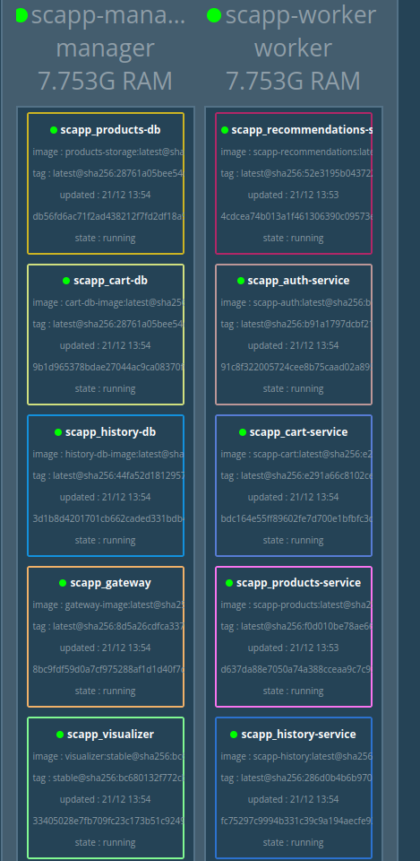
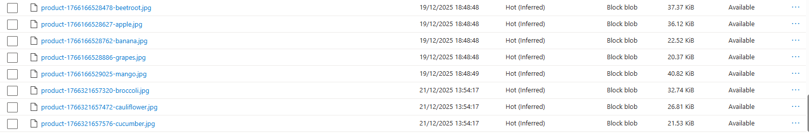
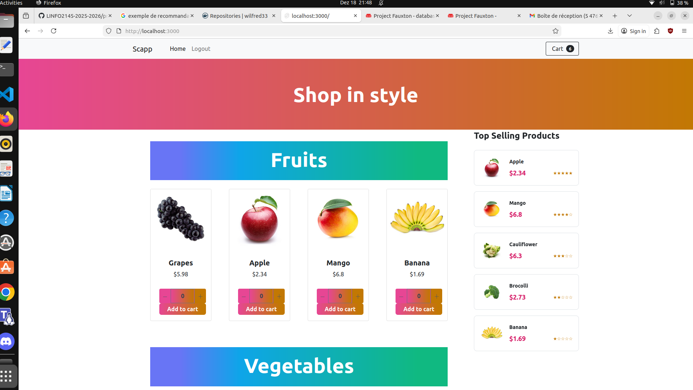
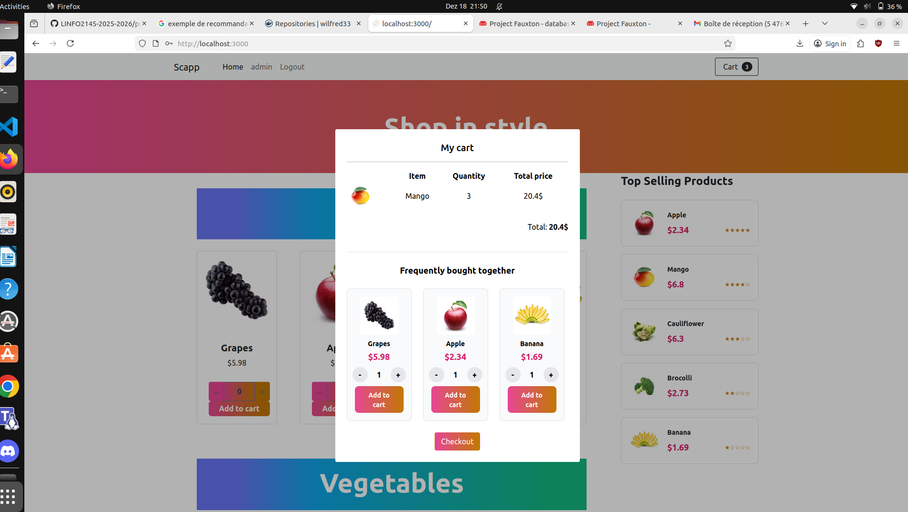
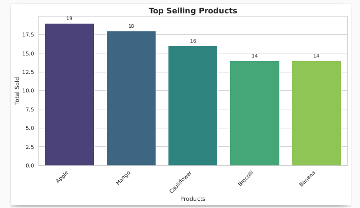
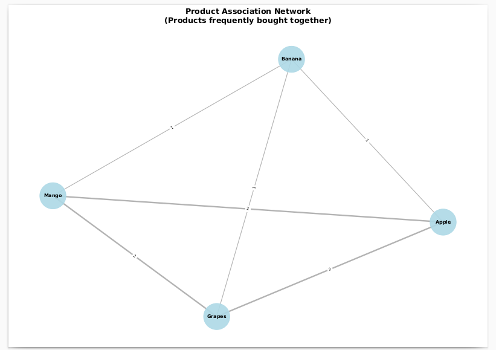

# Shopping Cart Application - Complete Documentation

**LINFO2145 Cloud Computing - Project 2024-2025**
**Group:** 52
**Date:** December 2025

---

## Table of Contents

### Phase 1 - Core Microservices Architecture
1. [Architecture Overview](#1-architecture-overview)
2. [Services Description](#2-services-description)
3. [Technology Stack Justification](#3-technology-stack-justification)
4. [Deployment with Docker Compose](#4-deployment-with-docker-compose)
5. [Deployment with Docker Swarm](#5-deployment-with-docker-swarm)
6. [Logging System](#6-logging-system)
7. [Image Storage on Azure](#7-image-storage-on-azure)

### Phase 2 - Recommendation System
8. [Phase 2 Introduction and Objectives](#8-phase-2-introduction-and-objectives)
9. [Recommendation System Architecture](#9-recommendation-system-architecture)
10. [Recommendation Algorithms (Map/Reduce)](#10-recommendation-algorithms-mapreduce)
11. [Frontend Integration](#11-frontend-integration)
12. [Data Visualization System](#12-data-visualization-system)
13. [Azure Deployment (Bonus)](#13-azure-deployment-bonus)
14. [Performance and Optimizations](#14-performance-and-optimizations)
15. [Conclusion](#15-conclusion)

---

# Phase 1 - Core Microservices Architecture

## 1. Architecture Overview

The application follows a **microservices architecture** pattern with clear separation of concerns:

```
┌─────────────┐
│   Frontend  │ (SvelteKit SSR)
│  Port 3000  │
└──────┬──────┘
       │
       ▼
┌─────────────┐
│  Gateway    │ (API Gateway - http-proxy-middleware)
│  Port 8082  │
└──────┬──────┘
       │
       ├──► Auth Service (Port 8080) ──► Users DB (CouchDB - Port 5984)
       │
       ├──► Products Service (Port 8081) ──► Products DB (CouchDB - Port 5985)
       │
       ├──► Cart Service (Port 8083) ──► Cart DB (CouchDB - Port 5986)
       │                                  (Cart actions logging)
       │
       ├──► History Service (Port 8084) ──► History DB (CouchDB - Port 5987)
       │                                     (Order logging)
       │
       └──► Recommendations Service (Port 8085) (Phase 2)
            └──► Analyzes History & Cart data
```

### Key Features

- **Separation of Concerns**: Each service has a unique and well-defined responsibility
- **Horizontal Scalability**: All services support elasticity via Docker Swarm replicas
- **Persistent State**: All data is stored in backend databases (CouchDB)
- **API Gateway Pattern**: Single entry point simplifies frontend communication
- **RESTful APIs**: Standard HTTP communication between services
- **Comprehensive Logging**: History and Cart services track user behavior for analytics

---

## 2. Services Description

### 2.1 Frontend Service

**Role:** Web user interface with server-side rendering (SSR)

**Technologies:**
- SvelteKit (SSR framework)
- JavaScript/HTML/CSS

**Docker Image:** `wilfred33/frontend-image:latest`

**Port:** 3000

**Features:**
- Product catalog with images
- User authentication (login/register)
- Shopping cart management
- Order history viewing
- Admin interface (CRUD operations on products)
- Trending products display (Phase 2)
- Cart-based product suggestions (Phase 2)

---

### 2.2 API Gateway

**Role:** Single entry point that routes requests to the appropriate microservices

**Technologies:**
- Node.js + Express.js
- http-proxy-middleware

**Docker Image:** `wilfred33/gateway-image:latest`

**Port:** 8082

**Routes:**
- `/user/*` → Auth Service (Port 8080)
- `/products/*` → Products Service (Port 8081)
- `/cart/*` → Cart Service (Port 8083)
- `/history/*` → History Service (Port 8084)
- `/recommendations/*` → Recommendations Service (Port 8085) *(Phase 2)*
- `/upload-image` → Products Service (image upload)
- `/upload-from-url` → Products Service (image upload from URL)

**Why Use an API Gateway?**

The API Gateway pattern is a fundamental architectural decision for our microservices application. Here's why:

**1. Single Entry Point**
- **Without Gateway**: Frontend must know the addresses of ALL microservices
  ```javascript
  fetch('http://auth-service:8080/user/login')
  fetch('http://products-service:8081/products')
  fetch('http://cart-service:8083/cart/user123')
  fetch('http://history-service:8084/history/user123')
  ```
- **With Gateway**: Frontend communicates with ONE address only
  ```javascript
  // Simple and maintainable
  fetch('http://gateway:8082/user/login')
  fetch('http://gateway:8082/products')
  fetch('http://gateway:8082/cart/user123')
  fetch('http://gateway:8082/history/user123')
  ```

**2. Frontend-Backend Decoupling**
- Frontend doesn't know the internal topology of microservices
- Services can be added/removed/moved without modifying the frontend
- Example: If Cart service moves from port 8083 to port 9000, only the Gateway needs updating

**3. Easy Architecture Evolution**
- Services can be refactored without breaking the frontend
- Example: Splitting Products service into "Products" + "Images" → Gateway handles the transition transparently

**4. Centralized Cross-Cutting Concerns**

The Gateway can easily add common functionality for ALL services:
- **Centralized Authentication**: Verify JWT before routing to services
- **Rate Limiting**: Limit requests per user
- **Centralized Logging**: Trace all requests in one place
- **Error Handling**: Return uniformly formatted errors
- **CORS**: Handle CORS headers once
- **Global Timeout**: Prevent frontend from waiting indefinitely

**5. Docker Swarm Compatibility and Elasticity**
- Services can have multiple replicas (e.g., 3 instances of Products Service)
- Gateway automatically routes to available replicas
- Docker Swarm handles internal load balancing via service names

**6. Network Simplification**
- Only one port exposed publicly (8082)
- Microservices remain in the internal Docker network (`scapp-network`)
- Better security: services are not directly accessible from outside

**7. Support for Both Docker Compose AND Docker Swarm**

Our Gateway uses environment variables to adapt:
```javascript
const PRODUCTS_SERVICE = process.env.PRODUCTS_SERVICE || 'products-container';
```
- **Docker Compose**: Uses `container_name` (e.g., `products-container`)
- **Docker Swarm**: Uses service names (e.g., `scapp_products-service`)

---

### 2.3 Auth Service

**Role:** User authentication and account management

**Technologies:**
- Node.js + Express.js
- bcrypt (password hashing)
- CouchDB for persistence

**Docker Image:** `wilfred33/scapp-auth:latest`

**Port:** 8080

**Database:** `users-db` (CouchDB - Port 5984)

**Features:**
- User account creation
- JWT authentication
- Secure password hashing with bcrypt
- Default admin account (admin/admin)

---

### 2.4 Products Service

**Role:** Product catalog and image management

**Technologies:**
- Node.js + Express.js
- CouchDB for product persistence
- Azure Blob Storage for images

**Docker Image:** `wilfred33/scapp-products:latest`

**Port:** 8081

**Database:** `products-db` (CouchDB - Port 5985)

**Storage:** Product images are stored on **Azure Blob Storage**

**Features:**
- Product CRUD operations
- Image upload (direct upload or from URL)
- Image storage on Azure Blob Storage
- Product search and filtering

---

### 2.5 Cart Service

**Role:** Shopping cart management per user + Cart action logging

**Technologies:**
- Node.js + Express.js
- CouchDB for persistence

**Docker Image:** `wilfred33/scapp-cart:latest`

**Port:** 8083

**Database:** `cart-db` (CouchDB - Port 5986)

**Features:**
- Retrieve user cart
- Add items to cart (with logging)
- Modify quantities (with logging)
- Remove items (with logging)
- Clear entire cart (with logging)

**Logging:** This service records all cart actions, enabling analysis of user behavior. This data is crucial for Phase 2 (recommendations based on products frequently added together to the cart).

---

### 2.6 History Service

**Role:** Order history management per user (Purchase logging)

**Technologies:**
- Node.js + Express.js
- CouchDB for persistence

**Docker Image:** `wilfred33/scapp-history:latest`

**Port:** 8084

**Database:** `history-db` (CouchDB - Port 5987)

**Features:**
- Retrieve user order history
- Add orders to history with full details (products, quantities, prices, date)
- Persist past purchases

**Logging:** This service constitutes a user order logging system. The stored data enables:
- Displaying purchase history to users
- **For Phase 2**: Analyzing which products are most frequently bought together to offer recommendations
- Sales statistics and analytics

---

### 2.7 Recommendations Service *(Phase 2)*

**Role:** Analyze purchase and cart data to generate product recommendations

**Technologies:**
- Node.js + Express.js
- nano (CouchDB client)
- Map/Reduce (CouchDB views)

**Docker Image:** `wilfred33/scapp-recommendations:latest`

**Port:** 8085 (internal), routed via Gateway

**Endpoints:**
- `GET /recommendations/trending` → Top 5 best-selling products
- `GET /recommendations/cart-suggestions/:productId` → Products frequently added with `:productId`
- `GET /health` → Health check

**Data Sources:**
- History DB (for sales analysis)
- Cart DB (for product association analysis)
- Products DB (to fetch product details)

---

## 3. Technology Stack Justification

### 3.1 Node.js & Express.js

**Choice:** All backend microservices use Node.js with Express.js

**Justification:**
- **Project Requirement**: "All services must be implemented in the node.js programming language"
- **Performance**: Event-driven, non-blocking I/O suitable for microservices
- **Consistency**: Same language across the entire backend facilitates maintenance
- **Rich Ecosystem**: NPM offers libraries for all our needs
- **Asynchronous**: Perfect for I/O-heavy operations (database queries, API calls)

### 3.2 CouchDB

**Choice:** CouchDB for all databases

**Justification:**
- **NoSQL Document-oriented**: Perfect for storing JSON objects (products, carts, orders)
- **Native HTTP RESTful API**: Integrates naturally with our REST microservices
- **Replication**: Native replication support for scalability
- **Map/Reduce**: Essential for Phase 2 (recommendation engine based on frequent purchases)
- **Efficient Logging**: History and Cart services use CouchDB to log user actions in a persistent and structured manner
- **Flexible Schema**: Easy to evolve data models without migrations

### 3.3 SvelteKit (Frontend)

**Choice:** SvelteKit with SSR (Server-Side Rendering)

**Justification:**
- **Performance**: Build-time compilation, no Virtual DOM overhead
- **SSR**: Improves SEO and first page load time
- **Modern**: Native reactivity without boilerplate
- **Developer Experience**: Less code, clearer syntax
- **Compatible**: Works seamlessly with our microservices architecture via API Gateway

### 3.4 Docker & Docker Swarm

**Choice:** Containerization with Docker, orchestration with Docker Swarm

**Justification:**
- **Project Requirement**: "multiple instances of the service as part of a Docker Swarm"
- **Isolation**: Each service runs in its own container
- **Portability**: "Build once, run anywhere"
- **Scalability**: Swarm enables horizontal scaling with `replicas`
- **Simplicity**: Easier to configure than Kubernetes for this project
- **Load Balancing**: Swarm automatically distributes requests between replicas
- **High Availability**: Service replicas ensure fault tolerance

### 3.5 JWT (JSON Web Tokens)

**Choice:** JWT for authentication

**Justification:**
- **Stateless**: No need for server-side sessions
- **Scalable**: Compatible with elasticity (no sticky sessions required)
- **Standard**: Widely adopted in microservices architectures
- **Secure**: Cryptographically signed with a secret
- **Self-Contained**: Contains all necessary user information

### 3.6 Azure Blob Storage

**Choice:** Azure Blob Storage for product images

**Justification:**
- **Scalability**: Can store unlimited images
- **Performance**: CDN-ready for fast image delivery
- **Reliability**: Microsoft Azure's 99.9% uptime SLA
- **Cost-Effective**: Pay only for storage used
- **Separation of Concerns**: Offloads image storage from application services

---

## 4. Deployment with Docker Compose

If you don't want to run Docker Compose locally go to the point 4.6, otherwise:
**Docker Compose** allows launching all containers at once, on any machine. It's the ideal tool for development and testing.

### 4.1 Launch All Services

```bash
cd /home/dell/projetcloudcomputing/LINFO2145-2025-2026/project/src
docker-compose up -d
```

This command:
- Builds images if necessary (or uses Docker Hub images)
- Creates the `scapp-network` network
- Launches all databases (CouchDB instances)
- Launches all microservices
- Launches the frontend
- Starts everything in the background (`-d` flag)

### 4.2 View Logs

**All services:**
```bash
docker-compose logs -f
```

**Specific service:**
```bash
docker-compose logs -f frontend
docker-compose logs -f gateway
docker-compose logs -f recommendations-service
```

### 4.3 Stop All Containers

```bash
docker-compose down
```

This command stops and removes all containers, but **preserves volumes** (data persists).

### 4.4 Manage Individual Services

```bash
# Stop specific service
docker-compose stop products-service

# Restart specific service
docker-compose start products-service

# Restart with rebuild (if code modified)
docker-compose up -d --build products-service
```

### 4.5 Access Services in Browser

Once all containers are running:

**Application:**
- **Frontend (Web app)**: http://localhost:3000
- **Gateway (API)**: http://localhost:8082

**Individual Services:**
- **Auth Service**: http://localhost:8080
- **Products Service**: http://localhost:8081
- **Cart Service**: http://localhost:8083
- **History Service**: http://localhost:8084
- **Recommendations Service**: http://localhost:8085

**Databases (Fauxton UI):**
- **Users DB**: http://localhost:5984/_utils
- **Products DB**: http://localhost:5985/_utils
- **Cart DB**: http://localhost:5986/_utils
- **History DB**: http://localhost:5987/_utils

**CouchDB credentials:** admin / admin

### 4.6 Direct Access (Without Running Locally)

**⚠️ If you don't want to run Docker Compose locally**, the application is already deployed and publicly accessible:

🌐 **Production Application (Azure)**:
- **Frontend**: http://scapp.westeurope.cloudapp.azure.com:3000
- **Gateway API**: http://scapp.westeurope.cloudapp.azure.com:8082
- **Visualizer**: http://scapp.westeurope.cloudapp.azure.com:80

**Note**: These URLs provide access to the complete application with all features (Phase 1 + Phase 2).

---

## 5. Deployment with Docker Swarm

### 5.1 Option A: Local Deployment (2 VMs with Multipass)

**⚠️ If you don't want to deploy locally**, the application is already deployed on Azure with Docker Swarm:

🌐 **Direct Access**:
- **Frontend**: http://scapp.westeurope.cloudapp.azure.com:3000
- **Gateway API**: http://scapp.westeurope.cloudapp.azure.com:8082
- **Visualizer**: http://scapp.westeurope.cloudapp.azure.com:80

**Azure Configuration**:
- **2 VMs**: 1 Manager + 1 Worker
- **Region**: West Europe
- **OS**: Ubuntu 22.04 LTS
- **Active Swarm** with all service replicas running

**Otherwise, follow these instructions for local deployment:**

#### Prerequisites

Install Multipass:
```bash
sudo snap install multipass
```

#### Automated Deployment

```bash
cd /home/dell/projetcloudcomputing/LINFO2145-2025-2026/project
./local-deploy.sh
```

**Visualizer Preview:**



This script will automatically:
1. Create 2 Ubuntu VMs (Manager + Worker)
2. Install Docker on both VMs
3. Initialize Docker Swarm
4. Join Worker to Swarm
5. Deploy the scapp stack

⏳ **Duration**: ~10-15 minutes

#### Access the Application

- **Frontend**: http://\<MANAGER_IP\>:3000
- **Gateway**: http://\<MANAGER_IP\>:8082
- **Visualizer**: http://\<MANAGER_IP\>:80
- **Databases**: Same as Docker Compose, using MANAGER_IP

#### Verify Deployment

```bash
./local-check-status.sh
```

This script checks:
- VMs exist and are running
- Docker is installed
- Swarm is active
- Stack is deployed
- Services are running

#### Cleanup

```bash
./local-cleanup.sh
```

This script:
- Stops both VMs
- Deletes both VMs
- Purges Multipass cache

---

## 6. Logging System

Our application uses **two types of logging** to track user actions, which are essential for Phase 2 (recommendation system).

### 6.1 History Service - Order Logging

**Purpose:** Record all orders placed by users

**Database:** `history-db` (CouchDB - Port 5987)

**Logged Data:**
- Order identifier
- User who placed the order
- Complete list of ordered products (id, name, price, quantity)
- Total order amount
- Order date and time

**Order Log Structure:**
```json
{
  "_id": "order:1700000000000:user123",
  "type": "order",
  "userId": "user123",
  "items": [
    {
      "productId": "product:1",
      "name": "Banana",
      "price": 2.5,
      "quantity": 3
    },
    {
      "productId": "product:5",
      "name": "Apple",
      "price": 3.0,
      "quantity": 2
    }
  ],
  "total": 13.5,
  "date": "2025-11-22T15:30:00.000Z"
}
```

**Benefits:**
- **Phase 1**: Enables users to view their purchase history
- **Phase 2**: Enables analysis of which products are frequently bought together
  - Example: "80% of customers who buy bananas also buy apples"
  - Powers recommendations like "Customers who bought this also bought..."

### 6.2 Cart Service - Cart Action Logging

**Purpose:** Record all actions performed on the cart (add, modify, delete)

**Database:** `cart-db` (CouchDB - Port 5986)

**Logged Data:**
- Product additions to cart
- Quantity modifications
- Product deletions
- Complete cart clearing

**Cart Structure (with implicit history):**
```json
{
  "_id": "cart:user123",
  "userId": "user123",
  "items": [
    {
      "productId": "product:1",
      "name": "Banana",
      "price": 2.5,
      "quantity": 3,
      "image": "https://projectcloudlinfo.blob.core.windows.net/...",
      "addedAt": "2025-11-22T14:00:00.000Z"
    }
  ],
  "total": 7.5,
  "lastModified": "2025-11-22T14:05:00.000Z"
}
```

**Benefits:**
- **Phase 1**: Manage user's active cart
- **Phase 2**: Analyze products frequently added together to cart
  - Even if not always purchased together, it indicates interest
  - Enables recommending complementary products
  - Example: "Customers who added bananas to cart also viewed..."

### 6.3 Application Logging *(Future Enhancement)*

**⚠️ Not implemented in current phases - Planned for future**

Application logging would track errors and application events to facilitate debugging.

**What would be logged:**
- **HTTP Errors**: Failed requests (4xx, 5xx)
- **Exceptions**: Unhandled errors in services
- **Timeouts**: Lost database connections
- **Admin Actions**: Product CRUD operations
- **Login Attempts**: Successful and failed authentications

**Why not now?**
- **Time Constraint**: Current phases focus on essential features
- **Priorities**: History and Cart logging are more critical for recommendations
- **Simplicity**: Docker logs (`docker logs`) are sufficient for current debugging needs

---

# 7. Azure Blob Storage Image Management System

## 7.1 Overview

The Products Service implements a  **Azure Blob Storage integration** that handles all product image operations. This cloud-native approach features automatic image processing, optimization, and lifecycle management, perfect for a e-commerce site.

## 7.2 Architecture

### Storage Flow
External URL → Download → Process (Sharp) → Upload (Azure) → Store URL (CouchDB)
### Key Components
1. **Image Processing Pipeline**: All images processed via Sharp library
2. **WebP Conversion**: Automatic format conversion for optimal compression
3. **Fixed Dimensions**: Consistent 166×166 pixel output
4. **Azure Integration**: Direct upload to Azure Blob Storage
5. **Lifecycle Management**: Automatic cleanup on product deletion

## 7.3 Image Processing

### 7.3.1 Image Processing Function
```javascript
async function processImage(buffer, originalName) {
  const image = sharp(buffer);
  const TARGET_WIDTH = 166;
  const TARGET_HEIGHT = 166;
  
  resizedImage = await image
    .resize(TARGET_WIDTH, TARGET_HEIGHT, {
      fit: 'cover',
      position: 'center'
    })
    .webp({ quality: 85 })
    .toBuffer();
  
  return {
    buffer: resizedImage,
    contentType: 'image/webp',
    optimized: true
  };
}
```

### Features:

-  Fixed Dimensions: All images resized to exactly 166×166 pixels

- Cover Crop: Maintains aspect ratio while filling space

- WebP Format: 85% quality for optimal size/quality balance

- Buffer Processing: No temporary files on disk

### Benefits
- Faster Loading: Smaller files load quicker

- Bandwidth Savings: Reduced data transfer

- Storage Efficiency: Lower Azure storage costs

- Consistent UI: Fixed dimensions prevent layout shifts


## 7.4 Naming Convention
Blob names follow pattern: product-{timestamp}-{originalName}.webp

Examples:





## 7.5 Environment Configuration
``` bash 
const connectionString = process.env.CONNECTIONSTRING 
const blobServiceClient = BlobServiceClient.fromConnectionString(connectionString);
const containerClient = blobServiceClient.getContainerClient('product-images');

```
The CONNECTIONSTRING is stored in the src/products/DockerFile
If you want to use your own Azure account you can change this variable.

## 7.6 Security Features
Input Validation
URL validation before processing

Content-Type verification during download

File extension whitelisting (.jpg, .jpeg, .png, .gif, .webp, .bmp)

# Phase 2 - Recommendation System

## 8. Phase 2 Introduction and Objectives

### 8.1 Context

**Phase 1** established the foundations of our e-commerce application with:
- Complete microservices architecture
- Logging system (History and Cart)
- Docker Swarm deployment
- Azure image storage

**Phase 2** leverages this logged data to implement an **intelligent recommendation system**.

### 8.2 Phase 2 Objectives

✅ **Objective 1: Recommendations Service**
- Create a new dedicated microservice for recommendations
- Use Map/Reduce (CouchDB) to analyze sales data
- Provide personalized recommendations based on purchase behavior

✅ **Objective 2: Frontend Integration**
- Display trending products (best-sellers)
- Suggest complementary products in the cart
- Intuitive and responsive user interface

✅ **Objective 3: Data Visualization**
- Generate sales analysis charts
- Visualize product associations
- Create an automated reporting system

✅ **Objective 4: Scalability**
- Elastic recommendation service (Docker Swarm)
- Optimized performance for large data volumes
- Caching to improve response times

### 8.3 Data Sources

Our system leverages data logged in Phase 1:

**A. History Database (`history-db`)**
```json
{
  "_id": "order:1700000000000:user123",
  "userId": "user123",
  "items": [
    {"productId": "product:1", "name": "Banana", "quantity": 3},
    {"productId": "product:5", "name": "Apple", "quantity": 2}
  ],
  "total": 13.5,
  "date": "2025-11-22T15:30:00.000Z"
}
```
→ **Usage**: Identify best-selling products (trending)

**B. Cart Database (`cart-db`)**
```json
{
  "_id": "cart:user123",
  "userId": "user123",
  "items": [
    {"productId": "product:1", "name": "Banana", "quantity": 3},
    {"productId": "product:5", "name": "Apple", "quantity": 1}
  ]
}
```
→ **Usage**: Analyze which products are added together to carts

---

## 9. Recommendation System Architecture

### 9.1 Architecture Overview

```
┌──────────────────┐
│   Frontend       │
│   (Svelte)       │
└────────┬─────────┘
         │
         ▼
┌──────────────────┐
│   API Gateway    │ ──► /recommendations/* → Recommendations Service
└────────┬─────────┘
         │
         ▼
┌─────────────────────────────────────┐
│  Recommendations Service (Node.js)  │
│  - Map/Reduce for trending          │
│  - Map/Reduce for associations      │
└────────┬───────────────┬────────────┘
         │               │
         ▼               ▼
┌────────────────┐  ┌──────────────┐  ┌──────────────┐
│  History DB    │  │  Cart DB     │  │  Products DB │
│  (CouchDB)     │  │  (CouchDB)   │  │  (CouchDB)   │
└────────────────┘  └──────────────┘  └──────────────┘
         │
         ▼
┌─────────────────────────┐
│  Recommendations        │
│  Plotter (Python)       │
│  - Matplotlib           │
│  - PDF Generation       │
└─────────────────────────┘
```

### 9.2 Recommendations Service Endpoints

#### Endpoint 1: Trending Products

**Route:** `GET /recommendations/trending`

**Purpose:** Return the top 5 best-selling products based on order history

**Response Example:**
```json
{
  "status": "success",
  "trending": [
    {
      "productId": "product:5",
      "totalSold": 45,
      "name": "Banana",
      "price": 2.5,
      "category": "Fruits",
      "image": "https://projectcloudlinfo.blob.core.windows.net/..."
    },
    {
      "productId": "product:2",
      "totalSold": 38,
      "name": "Apple",
      "price": 3.0,
      "category": "Fruits",
      "image": "https://projectcloudlinfo.blob.core.windows.net/..."
    }
  ]
}
```

#### Endpoint 2: Cart-Based Suggestions

**Route:** `GET /recommendations/cart-suggestions/:productId`

**Purpose:** Suggest products frequently added to cart with a given product

**Response Example:**
```json
{
  "status": "success",
  "suggestions": [
    {
      "productId": "product:10",
      "frequency": 15,
      "name": "Orange",
      "price": 1.8,
      "category": "Fruits",
      "image": "https://projectcloudlinfo.blob.core.windows.net/..."
    }
  ]
}
```

---

## 10. Recommendation Algorithms (Map/Reduce)

### 10.1 Why Map/Reduce?

**Map/Reduce** is a distributed programming paradigm that enables parallel processing of large datasets.

**Advantages for our use case:**
- ✅ **Scalability**: CouchDB automatically distributes computation
- ✅ **Performance**: Views are indexed and cached
- ✅ **Incremental**: Views update automatically when new data arrives
- ✅ **Simplicity**: CouchDB handles distribution complexity

### 10.2 Algorithm 1: Trending Products

**Goal:** Find the most sold products


### 10.3 Algorithm 2: Cart Associations

**Goal:** Find products frequently added together to cart


**Reduce Function:**
```javascript
reduce: '_sum'
```

**How it Works:**
1. **Map**: For each cart with 2+ products, emit all product pairs
2. **Reduce**: Count occurrences of each pair
3. **Query**: Retrieve all pairs starting with given `productId`

---

## 11. Frontend Integration

### 11.1 Trending Products Component

**Features:**
- Displays the top 5 best-selling products
- Real-time updates when new orders are placed
- Responsive design with product cards
- Shows product image, name, price, and total sales

**⚠️ Testing Recommendation:** For optimal testing of the recommendation service, **use the Azure deployed version** at [http://scapp.westeurope.cloudapp.azure.com:3000](http://scapp.westeurope.cloudapp.azure.com:3000) as it already contains pre-recorded data for realistic recommendation results.

**Screenshot:**



*Interface showing the 5 best-selling products with their images, names, prices, and total sales count.*

### 11.2 Cart Suggestions Component

**Features:**
- Displays suggestions based on current cart content
- Automatically appears when a product is added to cart
- Allows quick addition to cart
- Shows frequency of association

**Screenshot:**



*Product suggestions displayed below the cart, based on the first product in the cart. Users can directly add recommended suggestions.*

---

## 12. Data Visualization System

### 12.1 Recommendations Plotter (Python)

**Purpose:** Generate PDF charts to visualize recommendation data


### 12.2 Chart 1: Sales Histogram

**File:** `plot.py`

**Purpose:** Visualize the top 10 best-selling products as a histogram

**Process:**
1. Calls `GET /recommendations/trending`
2. Extracts product names and quantities sold
3. Generates histogram with Matplotlib
4. Saves as PDF (`plots/histogram.pdf`)

**Result:**



*Histogram showing the top selling products with their total quantities sold.*

### 12.3 Chart 2: Product Associations

**Purpose:** Visualize pairs of products frequently bought together

**Result:**



*Network graph showing products frequently added together to cart. The association frequency is shown on each link.*

### 12.4 Commands to Generate Charts

Follow these steps to generate all data visualization charts:

#### Step 1: Ensure Application is Running

```bash
# With Docker Compose
cd /home/dell/projetcloudcomputing/LINFO2145-2025-2026/project/src
docker-compose up -d

# OR with Docker Swarm (local)
cd /home/dell/projetcloudcomputing/LINFO2145-2025-2026/project
./local-deploy.sh
```

#### Step 2: Build the Plotter Docker Image

**Important:** You must build the Docker image before generating charts.

```bash
cd /home/dell/projetcloudcomputing/LINFO2145-2025-2026/project/src/recommendations_plotter

# Build the Docker image
docker build -t recommendations_plotter .
```

This command:
- Installs Python 3, Matplotlib, Requests, and dependencies
- Creates the `recommendations_plotter:latest` image
- Prepares the environment for chart generation

#### Step 3: Run Container to Generate Charts

**Method 1: Automatic Script (Recommended)**

```bash
cd /home/dell/projetcloudcomputing/LINFO2145-2025-2026/project/src/recommendations_plotter

# Run the automatic generation script
./generate_all_plots.sh
```

This script:
- Automatically launches the Docker container
- Generates all 3 charts in one command
- Produces: `histogram.pdf`, `product_associations.pdf`, `top_product_pairs.pdf`


#### Step 4: View Results

Charts are saved in the `plots/` folder:

```bash
# List generated charts
ls -lh plots/

# Open PDFs
xdg-open plots/histogram.pdf
xdg-open plots/product_associations.pdf
xdg-open plots/top_product_pairs.pdf
```

---

## 13. Azure Deployment (Bonus)

We deployed our shopping cart application with recommendation system on **Microsoft Azure**.

### 13.1 Deployment Configuration

**Infrastructure:**
- **2 VMs**: 1 Manager + 1 Worker
- **Region**: West Europe
- **OS**: Ubuntu 22.04 LTS
- **Orchestration**: Docker Swarm
- **Public DNS**: scapp.westeurope.cloudapp.azure.com

**Service Replicas:**
- Frontend: 1 replica
- Gateway: 1 replica
- Auth: 1 replica
- Products: 1 replicas
- Cart: 1 replicas
- History: 1 replicas
- Recommendations: 1 replicas
- Visualizer: 1 replica

### 13.2 Access URLs

**Live Application:**
- **Frontend**: http://scapp.westeurope.cloudapp.azure.com:3000
- **Gateway API**: http://scapp.westeurope.cloudapp.azure.com:8082
- **Visualizer (Architecture)**: http://scapp.westeurope.cloudapp.azure.com:80

**Note:** The application is running 24/7 with all Phase 1 and Phase 2 features enabled.

---

## 14. Performance and Optimizations

### 14.1 Potential Issues

- Map/Reduce can be slow on large databases
- View recalculation on each query
- Network latency between services

### 14.2 Implemented Solutions

**1. Indexed CouchDB Views**
- Map/Reduce results are cached
- Only new documents trigger view updates

**2. Incremental Updates**
- Only new documents are processed
- Existing results are reused

**3. Query Limits**
- Only retrieve top 5/10 results
- Reduces data transfer and processing

**4. Service Replicas**
- 2 replicas for critical services (Products, Cart, History, Recommendations)
- Docker Swarm load balancing
- High availability

### 14.3 Future Optimizations (Not Implemented)

**Redis Cache:**
- Cache recommendation results for 5-10 minutes
- Reduce database load
- Faster response times

**Pre-computation:**
- Recalculate views every hour (cron job)
- Even faster queries
- Predictable performance

**Pagination:**
- Support catalogs with thousands of products
- Lazy loading
- Reduced memory usage

---

## 15. Conclusion

### 15.1 Achievements

✅ **Phase 1 - Microservices Architecture**
- Complete microservices architecture implemented
- All services containerized with Docker
- API Gateway pattern for simplified communication
- Comprehensive logging system (History and Cart)
- Deployment with Docker Compose and Docker Swarm
- Azure Blob Storage integration for images

✅ **Phase 2 - Recommendation System**
- Functional recommendation service with Map/Reduce algorithms
- Two types of recommendations (trending + cart-based)
- Frontend integration with responsive components
- Data visualization system with automated chart generation
- Performance optimized with indexed views
- 2 replicas for high availability

✅ **Deployment**
- Docker Compose for local development
- Docker Swarm for production deployment
- Azure cloud deployment (2 VMs, West Europe)
- Automated deployment scripts for local Swarm (Multipass)

### 15.2 Strengths

🏆 **Complete Microservices Architecture**
- Recommendation service fully decoupled
- Communication via API Gateway
- No modifications to existing services required
- Clear separation of concerns

🏆 **Intelligent Data Utilization**
- Phase 1 logging directly used in Phase 2
- Distributed Map/Reduce for scalability
- Proven algorithms (frequent itemsets)

🏆 **Improved User Experience**
- Relevant suggestions based on real behavior
- Responsive and modern interface
- Helps users make purchase decisions

🏆 **Production-Ready Deployment**
- Live on Azure with public access
- Docker Swarm orchestration
- Load balancing and high availability
- Automated deployment scripts

### 15.3 Technical Highlights

**CouchDB Map/Reduce:**
- Efficient distributed computation
- Automatic view indexing and caching
- Incremental updates

**Docker Swarm:**
- Horizontal scalability with replicas
- Built-in load balancing
- Service discovery
- Rolling updates

**Azure Integration:**
- Blob Storage for images
- VM-based Swarm cluster
- Public DNS configuration
- Cost-effective cloud deployment

---

**End of Documentation**

**Group 52 - LINFO2145 Cloud Computing - 2024-2025**
